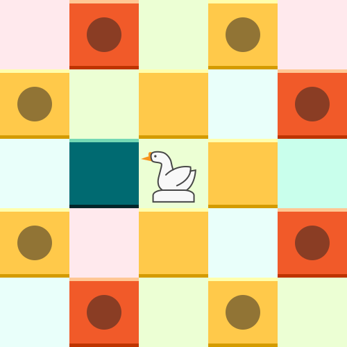
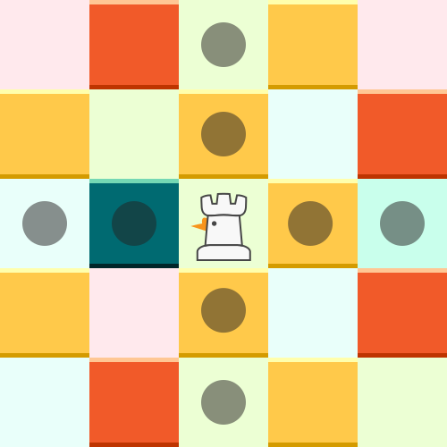
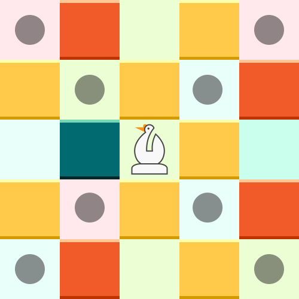
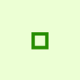
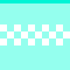

# Makrukhan

Start on b1, collect as many points as you can, and finish on a Final Pond.

**Play it here: https://finyakginshabu.github.io/makrukhan/**

[ภาษาไทยอยู่ด้านล่าง](#อัศวินห่านห้าวหาญนักล่าแต้ม)

In this point-hunting contest on a very special chessboard, you are a brave and brilliant goose who wants to collect as many points as possible and rise to first place.

To solve this puzzle you need to know a few basic chess moves. These are the pieces used here.

| Knight | Rook | Bishop |
|:---:|:---:|:---:|
|  |  |  |
| Moves two squares in one direction, then one square at a right angle, like an ‘L’. | Moves any number of squares in a straight line (up, down, left or right) to the edge of the board, like a ‘+’. | Moves any number of squares diagonally to the edge of the board, like an ‘X’. |

## How to play

Plan the brave goose's (knight's) route, starting from b1, to collect as many points as you can. Each square has an effect that depends on its type and value. Every move costs you 10% of the points you have, and your final score is whatever you have when you reach a Final Pond.

## Square types

| | Square | Effect |
|:---:|---|---|
|  | **Treasure** | You gain the number of points shown on the square. |
|  | **Blessing** | You gain the percentage shown of the points you have. |
|  | **Safe Zone** | Moving onto this square doesn't cost you 10%. |
|  | **Knight's Armour** | Your next moves, as many as shown, don't cost you 10%. |
|  | **Multiplier Magic** | If your next move lands on a Treasure square, its points are multiplied by the value shown. |
|  | **Warrior Spirit** | Your next move is made as the piece shown on the square. |
|  | **Final Pond** | The game ends when you move here, and this move doesn't cost you 10%. |

> Treasure and Blessing squares only work the first time you land on them.

Move by tapping a target square or dragging your piece onto it. Once you reach a Final Pond, you can restart or submit your answer.

---

# อัศวินห่านห้าวหาญนักล่าแต้ม

เริ่มที่ช่อง b1 เก็บแต้มให้ได้มากที่สุด แล้วไปจบที่ช่องบ่อน้ำที่สิ้นสุด

**เล่นได้ที่: https://finyakginshabu.github.io/makrukhan/**

เกมการแข่งขันล่าแต้มบนตารางหมากรุกสุดพิเศษนี้ คุณเป็นห่านห้าวหาญและปราดเปรื่องผู้ปรารถนาเก็บแต้มให้ได้มากเพื่อก้าวขึ้นเป็นอันดับหนึ่งของการแข่งขัน

เพื่อแก้โจทย์ข้อนี้ คุณจำเป็นต้องทำความรู้จักรูปแบบการเดินของหมากรุกเบื้องต้น ในที่นี้จะแนะนำการเดินของหมากที่มีในโจทย์

| อัศวิน | เรือ | บิชอป |
|:---:|:---:|:---:|
|  |  |  |
| เดินสองช่องไปทางใดทางหนึ่งและเดินอีกหนึ่งช่องในทิศทางตั้งฉาก คล้ายกับ ‘L’ | เดินในแนวตรง (แนวตั้งหรือแนวนอน) ได้ไกลจนสุดขอบตาราง คล้ายกับ ‘+’ | เดินในแนวทแยงได้ไกลจนสุดขอบตาราง คล้ายกับ ‘X’ |

## วิธีการเล่น

ออกแบบการเดินหมากห่านห้าวหาญ (อัศวิน) เริ่มต้นที่ช่อง b1 เพื่อเก็บแต้มให้มากที่สุด แต่ละช่องจะมีผลตามประเภทและค่าของช่องนั้น ๆ โดยในทุกการเดิน คุณจะถูกหักแต้มออก 10% ของแต้มที่คุณมีอยู่ และจะนับแต้มที่คุณได้ตามแต้มสุดท้ายที่คุณมีอยู่เมื่อเข้าสู่ช่องบ่อน้ำที่สิ้นสุด

## ประเภทผลของช่อง

| | ช่อง | ผล |
|:---:|---|---|
|  | **ช่องขุมทรัพย์** | คุณจะได้รับแต้มเพิ่มตามค่าที่แสดงบนช่อง |
|  | **ช่องคำอวยพร** | คุณจะได้รับแต้มเพิ่มร้อยละตามค่าที่แสดงของแต้มที่คุณมีอยู่ |
|  | **ช่องเขตปลอดภัย** | การเดินหมากเข้าช่องนี้ คุณจะไม่ถูกหักแต้มออก 10% |
|  | **ช่องเกราะอัศวิน** | การเดินหมากครั้งถัดไปตามค่าที่แสดง คุณจะไม่ถูกหักแต้มออก 10% |
|  | **ช่องเวทมนตร์ทวีคูณ** | หากการเดินหมากครั้งถัดไปเป็นช่องขุมทรัพย์ คุณจะได้แต้มเป็นจำนวนเท่าตามค่าที่แสดงของแต้มจากช่องขุมทรัพย์ |
|  | **ช่องวิญญาณนักรบ** | การเดินหมากครั้งถัดไปจะเป็นรูปแบบของหมากตามสัญลักษณ์ที่แสดง |
|  | **ช่องบ่อน้ำที่สิ้นสุด** | เกมจะจบลงเมื่อคุณเดินหมากเข้าช่องนี้ ซึ่งคุณจะไม่ถูกหักแต้มออก 10% |

> หากคุณเดินหมากเข้าช่องขุมทรัพย์หรือช่องคำอวยพร ช่องนั้น ๆ จะไม่มีผลเป็นครั้งที่สอง

คุณสามารถเดินหมากได้โดยเลือกช่องเป้าหมายหรือลากหมากของคุณไปยังช่องเป้าหมาย เมื่อเข้าช่องบ่อน้ำที่สิ้นสุดแล้ว คุณสามารถเลือกเริ่มเล่นใหม่หรือเลือกส่งคำตอบได้
